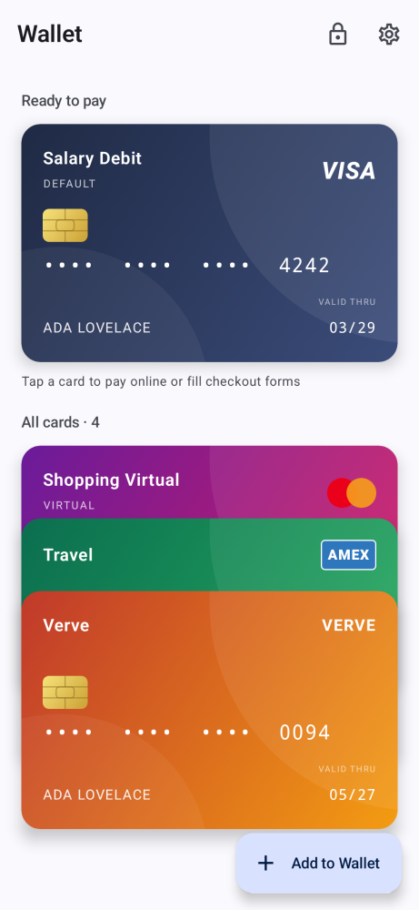
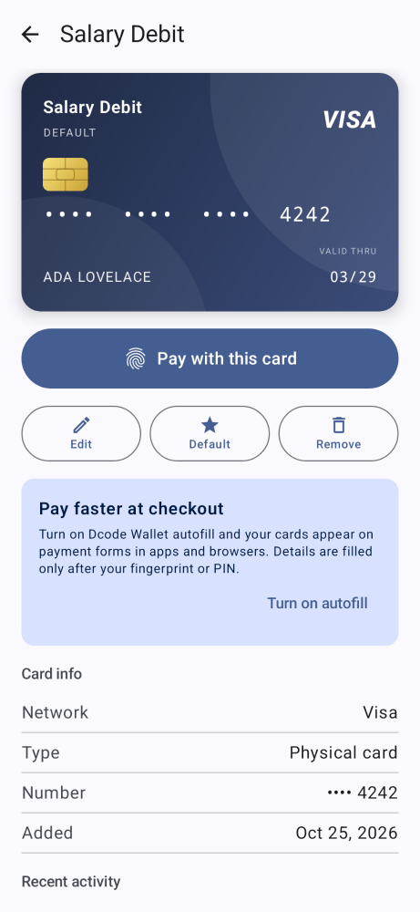
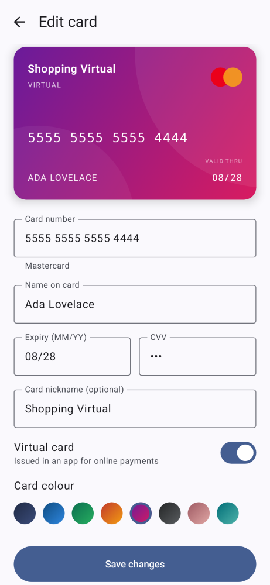
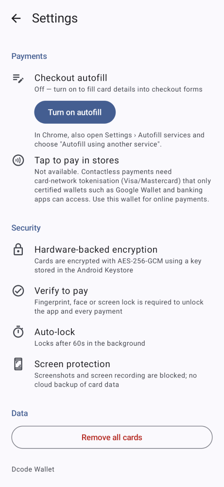

# Dcode Wallet (Android MVP)

A Google Wallet–style app for storing your bank cards and virtual cards on your phone and paying with them online.

**Download:** [`release/DcodeWallet-v1.0.0.apk`](release/DcodeWallet-v1.0.0.apk). Requires Android 8.0 or later.

| Home | Card | Add / edit | Settings |
|---|---|---|---|
|  |  |  |  |

## Features

- **Store cards.** Add debit, credit and virtual cards. The app detects the network (Visa, Mastercard, Amex, Verve, Discover, JCB, Diners, UnionPay, RuPay, Maestro), checks the number with the Luhn algorithm, validates expiry and CVV, and lets you set a nickname and card colour.
- **Pay online with a card.**
  - **Pay with this card:** after you verify with fingerprint or PIN, the app shows the full number, expiry and CVV, each with a copy button. The details hide again after 60 seconds, and copied values are cleared from the clipboard after 60 seconds.
  - **Checkout autofill:** turn on *Dcode Wallet* as your autofill service. On a payment form in another app or a browser, your cards appear as suggestions. When you pick one and verify, the app fills in the card number, name, expiry (text box or dropdowns) and CVV.
- **Default card** is shown first under "Ready to pay" and listed first in autofill suggestions.
- **Recent activity** for each card records when its details were unlocked and where it was autofilled (website or app).

## Security

- The whole wallet is stored as one file encrypted with **AES-256-GCM**. The key is held in the **Android Keystore** (hardware-backed on most phones) and never leaves it.
- The app requires your fingerprint, face or screen lock to open, and again for every payment. It locks itself after 60 seconds in the background.
- Screenshots and screen recording are blocked (`FLAG_SECURE`). Cloud backup and device-transfer backup are turned off, so card data never leaves the phone.

## What it can't do: tap to pay in stores

Paying contactlessly at a shop terminal needs **network tokenisation** from Visa or Mastercard (VTS/MDES). Card networks only give that to certified wallets and card issuers, such as Google Wallet, Samsung Pay and banking apps. A personal app cannot produce the payment cryptograms a terminal checks, so this MVP is built for **online payments** only.

## Installing the APK

1. Copy `DcodeWallet-v1.0.0.apk` to your phone, or open this repo on GitHub from your phone and download it.
2. Open the file. If Android asks, allow your browser or file manager to *install unknown apps*.
3. Your phone needs a screen lock. The app will ask you to set one up if you don't have one.
4. Optional: go to **Settings → Turn on autofill** in the app. In Chrome, also open *Settings → Autofill services* and choose **"Autofill using another service"**.

## Building

```bash
./gradlew testDebugUnitTest   # unit tests
./gradlew assembleRelease     # app/build/outputs/apk/release/app-release.apk
```

You need JDK 17+ and the Android SDK (platform 35). To sign release builds with your own key, create an untracked `keystore.properties` file containing `storeFile`, `storePassword`, `keyAlias` and `keyPassword`. If that file is missing, release builds are signed with the debug key.

**Stack:** Kotlin, Jetpack Compose with Material 3, AndroidX Biometric, Android Keystore, Android Autofill Framework.
